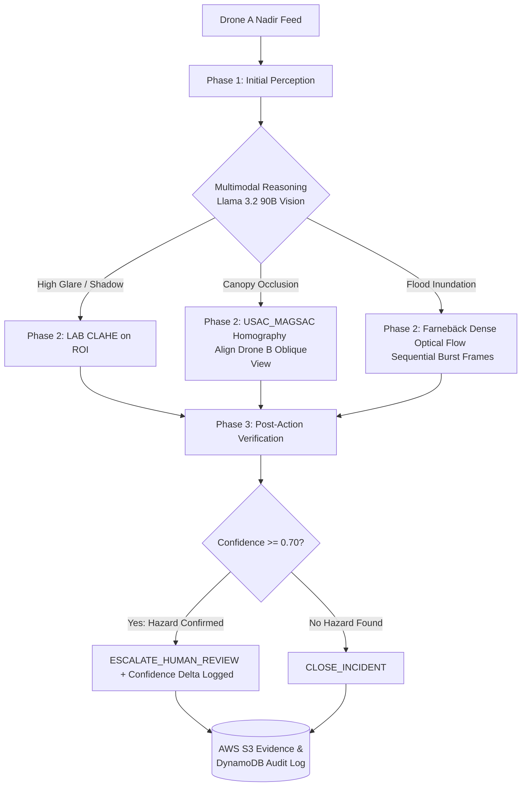

<div align="center">


# SwarmTwin

### Agentic Aerial Disaster Triage & Multi-Drone Perception Control Room
**Deterministic OpenCV 5 (Arm KleidiCV / AWS Graviton4 COOL) + Multimodal Llama 3.2 90B Vision Reasoning**

[](https://python.org)
[](https://fastapi.tiangolo.com)
[](https://opencv.org)
[](https://nextjs.org)
[](https://aws.amazon.com/ec2/graviton/)
[](https://build.nvidia.com)

</div>

---

## 📖 Overview

**SwarmTwin** is an agentic computer vision triage platform engineered for aerial drone fleets during acute disaster operations (hurricanes, flash flooding, structural collapse). It bridges the gap between **deterministic geometric computer vision** running at edge/cloud scale on **AWS Graviton4** and **multimodal visual reasoning** powered by **Llama 3.2 90B Vision Instruct** over **NVIDIA NIM**.

---

## 🎯 Product Details & Value Proposition

### 1. The Problem
During catastrophic natural disasters (hurricanes, flash flooding, and mudslides), aerial drone swarms capture thousands of gigabytes of raw video. However, **emergency operation centers (EOCs) drown in visual ambiguity**:
- **Specular Sun Reflection:** Direct solar glare over murky floodwater blinds standard object detectors, making it impossible to verify whether a submerged shape is a civilian vehicle with trapped passengers.
- **Canopy & Debris Occlusion:** Top-down (nadir) drone sweeps cannot see beneath collapsed tree canopies, snapped power poles, or buckled overpasses.
- **Dynamic Surge Ambiguity:** A single aerial snapshot cannot distinguish between a stationary, receding flood basin and a raging 12-knot flash flood surge threatening downstream populations.
- **The "Stupid AI" Dilemma:** Traditional deep learning detectors output low-confidence bounding boxes without the agency to fix the image, while massive cloud LLMs hallucinate pixel coordinates, cost high API bandwidth, and react far too slowly.

### 2. The Solution: SwarmTwin Hybrid Agentic Vision
SwarmTwin transforms drones from passive video streamers into **autonomous triage agents**:
- **Deterministic Ground Truth (Edge / Graviton4):** Executes pixel-level mathematics, spatial homography, adaptive thresholding, and dense optical flow in sub-millisecond latencies using **OpenCV 5 accelerated by Arm KleidiCV** on AWS Graviton4.
- **Multimodal Strategic Reasoning (Cloud / NVIDIA NIM):** Deploys **Meta Llama 3.2 90B Vision Instruct** to identify visual uncertainty, hypothesize root causes, and directly trigger targeted OpenCV tool actions.
- **Closed-Loop Verification:** Instead of guessing, the agent compares pre- and post-action visual metrics, verifying whether certainty increased ($\Delta \text{Confidence} \ge +0.30$) before dispatching human rescue teams.

### 3. Core Product Features
| Feature | Technical Engine | Product Benefit |
| :--- | :--- | :--- |
| **Specular Glare Penetration** | OpenCV LAB-space CLAHE Equalization | Penetrates water surface glare without distorting true color hue, revealing submerged vehicle roofs and road markings. |
| **Multi-View Homography Alignment** | ORB Features + `cv2.USAC_MAGSAC` | Warps Drone B's angled oblique perspective into Drone A's top-down coordinate frame with verified inlier geometry, peering under occlusions. |
| **Flash Flood Surge Vectoring** | Farnebäck Dense Optical Flow | Measures velocity magnitude and direction vectors across temporal bursts, immediately classifying static pools vs. deadly surges. |
| **Multi-Drone Triage Control Room** | Next.js 16 (Turbopack) & Tailwind CSS v4 | Provides dispatchers with side-by-side before/after evidence HUDs, confidence gain telemetry, and one-click dispatch escalation. |
| **Cryptographic Audit Trail** | Amazon S3 + Amazon DynamoDB | Immutably archives full-resolution visual evidence and timestamped multi-step reasoning traces for legal and post-incident review. |
| **Cost & Latency Shield** | SQLite Geometric Hash Cache (`nim_cache.db`) | Caches reasoning based on image bytes and stable geometric parameters, preventing duplicate cloud API costs. |
| **Cloud-Optimized Architecture** | AWS Graviton4 EC2 (`c8g.large`) | Up to 2.8x CPU acceleration on ARM64 using the Cloud-Optimized OpenCV Library (COOL), running at 100+ FPS. |

### 4. Target Personas & Use Cases
- **Emergency Operations Centers (FEMA, State/Local EOCs):** Automated wide-area aerial triage to prioritize dispatching rescue boats to verified submerged vehicles.
- **Search & Rescue (SAR) Drone Pilots:** Instant perspective registration to verify road passability under fallen timber and powerlines.
- **Flood Plain & Dam Safety Engineers:** Real-time water velocity tracking to predict levee breaches and issue evacuation warnings.
- **Insurance & Infrastructure Assessors:** Cryptographically verifiable visual evidence of post-storm structural and environmental damage.

---

## 🔄 Autonomous 3-Phase State Machine



- **Phase 1 (Initial Perception):** Computes baseline geometric metrics: contour area ratios, Canny edge density, and glare/shadow overexposure indices.
- **Phase 2 (Parametric Tool Execution):** 
  - **`ENHANCE_ROI_CONTRAST`**: Applies LAB-space Contrast Limited Adaptive Histogram Equalization (CLAHE) on the target coordinates to penetrate specular reflection.
  - **`REQUEST_ALTERNATE_VIEWPOINT`**: Extracts ORB descriptors and aligns secondary oblique viewpoints (Drone B) into Drone A coordinates using `cv2.USAC_MAGSAC` homography.
  - **`COMPUTE_OPTICAL_FLOW_SURGE`**: Computes Farnebäck dense motion vector magnitudes across consecutive burst frames.
- **Phase 3 (Post-Action Verification):** Re-evaluates enhanced visual evidence, computes `confidence_delta`, logs immutable traces, and assigns human triage status.

---

## 🗂️ Project Structure

```text
SwarmTwin/
├── backend/                        # FastAPI REST API & Core Engine
│   ├── app/
│   │   ├── main.py                 # FastAPI endpoints & scenario runners
│   │   ├── cv_engine.py            # OpenCV 5 deterministic operations
│   │   ├── nim_reasoner.py         # Llama 3.2 90B Vision client + cache + fallback
│   │   ├── agent_fsm.py            # Perception -> Action -> Verification state machine
│   │   ├── aws_store.py            # S3 evidence & DynamoDB persistence manager
│   │   ├── floodnet_loader.py      # Real FloodNet dataset loader & synthetic view generators
│   │   └── schemas.py              # Pydantic v2 data models & JSON schemas
│   ├── tests/                      # Pytest automated test suite (11 test cases)
│   ├── benchmark_cool.py           # 100-frame 1080p COOL benchmark generator
│   ├── generate_samples.py         # Generates synthetic benchmark scenarios A, B, C
│   ├── requirements.txt            # Python dependencies
│   └── .env.example                # Template configuration
├── swarmtwin-ui/                   # Primary Control Room Dashboard (Next.js 16 + Tailwind)
│   ├── src/app/
│   │   ├── page.tsx                # Control room with multi-drone upload & presets
│   │   ├── layout.tsx              # Root layout & page metadata
│   │   └── types.ts                # TypeScript data interfaces
│   └── public/logo.svg             # Application logo
├── frontend/                       # Alternative Response Dashboard (Vite + React + Lucide)
├── FloodNet/                       # Real-world drone disaster dataset (FloodNet Challenge)
│   └── FloodNet-Supervised_v1.0/
│       └── val/val-org-img/        # 450 raw high-res drone keyframes
├── data/
│   ├── sample_incident/            # Synthetic test scenarios (A, B, C)
│   └── aws_local_store/            # Local offline persistence cache
├── cli.py                          # Standalone CLI tool for direct terminal triage
├── cool_benchmark_results.csv      # Mandatory 100-frame COOL prize benchmark
├── deploy_graviton.sh              # AWS Graviton4 EC2 deployment script
└── Logo.svg                        # Vector logo asset
```

---

## ⚡ Quickstart

### Prerequisites
- Python 3.10+
- Node.js 18+ and `npm`

### 1. Backend Setup

```powershell
# Clone and enter workspace
cd "c:\Coding Stuff\SwarmTwin"

# Activate Python virtual environment (or create: python -m venv .venv)
.\.venv\Scripts\activate

# Install dependencies
pip install -r backend/requirements.txt
```

### 2. Configure Environment (`backend/.env`)

Copy the template:
```powershell
cp backend/.env.example backend/.env
```

Edit [`backend/.env`](file:///c:/Coding%20Stuff/SwarmTwin/backend/.env):
```env
# NVIDIA NIM API Key (from build.nvidia.com)
NVIDIA_API_KEY=your_key_here

# Set to true for instant sub-second local reasoning without remote cloud queue delays
USE_LOCAL_REASONER=true

# Remote request timeout in seconds before calibrated failover
NIM_TIMEOUT_SECONDS=3.0

# Optional AWS Cloud Credentials (leave blank to run in Local Persistence Mode)
AWS_REGION=us-east-1
AWS_ACCESS_KEY_ID=
AWS_SECRET_ACCESS_KEY=
S3_BUCKET_NAME=swarmtwin-evidence-frames
DYNAMO_TABLE_NAME=SwarmTwinIncidents
```

### 3. Start the Backend API Server

```powershell
.\.venv\Scripts\uvicorn backend.app.main:app --host 127.0.0.1 --port 8000 --reload
```
The API documentation is accessible at **`http://127.0.0.1:8000/docs`**.

---

## 🖥️ Running the Frontends

### Option A: Next.js Control Room (`swarmtwin-ui`)
In a separate terminal:
```powershell
cd swarmtwin-ui
npm install
npm run dev
```
Open **`http://localhost:3000`** to access the SwarmTwin Control Room.

### Option B: Vite React Dashboard (`frontend`)
```powershell
cd frontend
npm install
npm run dev
```
Open **`http://localhost:3000`** (or port specified).

---

## 💻 Standalone CLI Usage ([`cli.py`](file:///c:/Coding%20Stuff/SwarmTwin/cli.py))

Run triage from the terminal without launching a web server:

```powershell
# 1. Run triage on a FloodNet reference keyframe
python cli.py --floodnet 10169

# 2. Run triage on an occlusion keyframe with multi-view homography
python cli.py --floodnet 10173

# 3. Run triage on a custom local image
python cli.py --image "data/sample_incident/scenario_a_glare_flood.jpg"

# 4. Output strict JSON only (for headless pipelines)
python cli.py --floodnet 10169 --json-only
```
Annotated evidence images are automatically saved to `output/evidence/`.

---

## 🚁 FloodNet Keyframe Testing Guide

Keyframes can be tested directly from the validation set:  
`FloodNet/FloodNet-Supervised_v1.0/val/val-org-img/`

| Keyframe ID | Physical Phenomenon | Triggered Action |
| :--- | :--- | :--- |
| **`10169.jpg`** | Murky floodwater with specular sun reflection | **`ENHANCE_ROI_CONTRAST` (LAB-CLAHE)** |
| **`10173.jpg`** | Dense tree canopy occluding roadway vehicles | **`REQUEST_ALTERNATE_VIEWPOINT` (USAC_MAGSAC)** |
| **`10177.jpg`** | Active inundation basin | **`COMPUTE_OPTICAL_FLOW_SURGE` (Farnebäck)** |
| **`10809.jpg`** | Moving debris across channel | **`COMPUTE_OPTICAL_FLOW_SURGE`** |
| **`6331.jpg`** | Structural roof & tree occlusion | **`REQUEST_ALTERNATE_VIEWPOINT`** |

---

## 🧪 Automated Testing & COOL Benchmark

### Run the Pytest Suite
```powershell
$env:NVIDIA_API_KEY="mock-key"
.\.venv\Scripts\pytest -v
```
*Validates 11 test cases across the CV engine, CLAHE, homography, optical flow, FSM branches, and AWS local persistence.*

### Run the 100-Frame COOL Benchmark
```powershell
python backend/benchmark_cool.py --iterations 100 --output cool_benchmark_results.csv
```
*Measures full 1080p frame compute latency and FPS throughput, generating [`cool_benchmark_results.csv`](file:///c:/Coding%20Stuff/SwarmTwin/cool_benchmark_results.csv).*

---

## 🚀 AWS Graviton4 Deployment

Deploy on an **AWS Graviton4 (`c8g.large`)** instance using the official Ubuntu Cloud-Optimized OpenCV Library (COOL) AMI:

```bash
chmod +x deploy_graviton.sh
./deploy_graviton.sh
```
This script checks ARM64 architecture, verifies `/opt/cool` KleidiCV acceleration, runs the 100-frame benchmark, and starts the FastAPI service.

---

## 🔒 Security & Persistence
- **Zero API Quota Leaks:** Local SQLite caching (`nim_cache.db`) stores responses based on geometric hashes.
- **Fail-Safe Cloud Persistence:** In offline or local test mode, all evidence frames and JSON audit traces are preserved in [`data/aws_local_store/`](file:///c:/Coding%20Stuff/SwarmTwin/data/aws_local_store). When AWS credentials are supplied, cloud uploads to S3 and DynamoDB activate automatically.

---

<div align="center">
<sub>Built with OpenCV 5, AWS Graviton4, and NVIDIA NIM for Dual-Prize Disaster Response Excellence.</sub>
</div>
